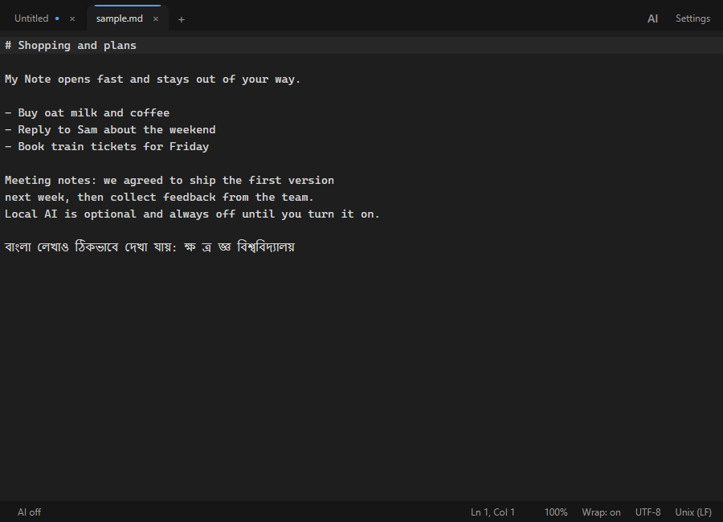
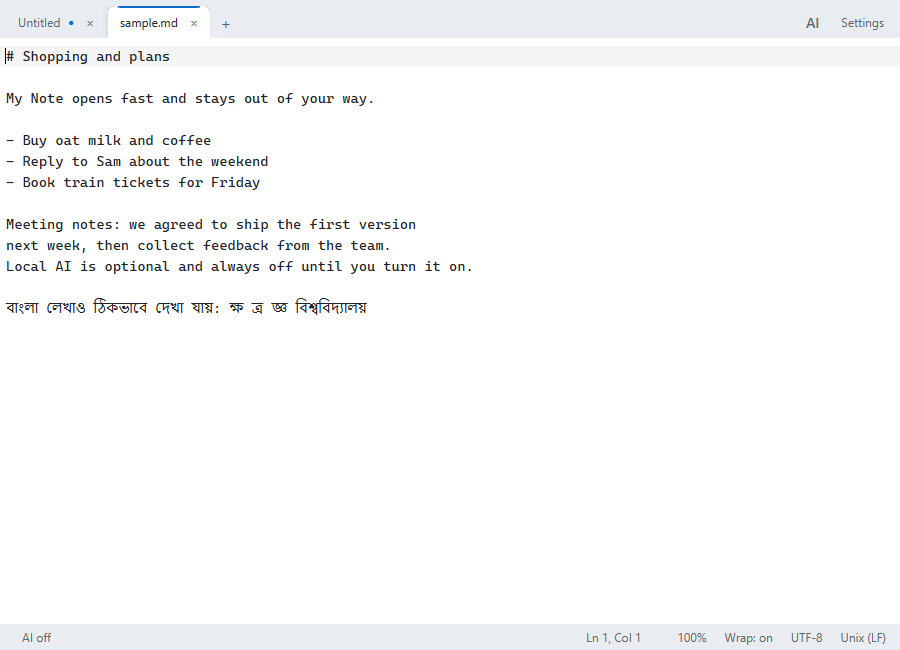

# My Note

A fast, modern, cross-platform notepad with optional local or remote AI.

Built with Tauri v2 (Rust backend), vanilla TypeScript, Vite and CodeMirror 6. No UI framework.





## Features

- Tabs, open and save, with Windows Notepad's basic behaviour.
- Encodings: UTF-8, UTF-8 with BOM, UTF-16 LE/BE with BOM, Windows-1252. Line endings: CRLF and LF. Each file keeps its own encoding and line ending.
- Find and replace, go to line, print, zoom, word wrap.
- Insert date and time (F5).
- Session restore: unsaved tabs come back after a restart or a crash.
- Spell check (red wavy underline, right-click suggestions, Add to dictionary, Ignore) and autocorrect of common typos, both offline and switchable per file type. English (US) is built in; other languages are Hunspell `.dic` + `.aff` files from a folder you choose (nothing is downloaded). Words in a writing system with no loaded dictionary, such as Bengali, are never underlined.
- Markdown mode for `.md` files (and any tab on request): syntax colours, a formatting toolbar (bold, italic, strikethrough, headings, lists, link, code, quote, table), list continuation with Tab / Shift+Tab nesting, pipe tables that stay aligned (Tab between cells, row and column menu), and Source / Split / Preview views. The preview shows no raw HTML or scripts, opens links only in your browser after you confirm (http, https, mailto), and loads remote images only after you agree, once per file. Files stay plain Markdown.
- Themes (system, light, dark), font and tab settings in a Settings tab.
- Optional transparency and blur, with a solid fallback, a Reduce effects setting and a `--no-effects` flag.
- Optional AI actions (off by default): summarize, fix grammar, shorten, rewrite, change tone, translate, continue writing, or your own instruction. Results go to a preview first. Accept applies one undoable change and keeps a rollback history.
- AI works on the selection if text is selected, otherwise on the whole file. The status bar always shows which, and whether the AI is local or remote.

## Download and install

Go to [GitHub Releases](https://github.com/Rafat-Pantho/my-note/releases) and download the file you want:

- `My.Note_<version>_x64-setup.exe` or `My.Note_<version>_x64_en-US.msi`: Windows installer. The installer fetches WebView2 only if it is missing.
- `My-Note_<version>_windows-x64-portable.zip`: the program as a single exe, no install.
- macOS (`.dmg`) and Linux (`.deb`, `.rpm`, `.AppImage`) builds are produced by the release workflow. They are not tested on every release.
- `SHA256SUMS`: check your download against it.

**Windows builds are unsigned.** Windows SmartScreen may show a warning the first time you run them. Choose *More info* and then *Run anyway* only if you downloaded the file from the release page above.

## Privacy

- **AI is off by default.** Nothing AI-related runs until you turn it on in Settings.
- **Consent before any connection.** For a local Ollama, My Note asks before it connects. For any other host you enter, it shows the host and asks first. If you say no, it never connects and remembers the choice. You can change it in Settings.
- **Remote services** are used only after you enter a key and approve the host shown.
- **Text leaves your machine only when you run an AI action.** The status bar shows the active AI environment and whether it is local or remote.
- **API keys are stored in the OS keychain** (Windows Credential Manager on Windows; the macOS and Linux keychain on those systems). They are not written to config files or logs, and the page never reads them back after saving.
- **Nothing is installed for you.** My Note only checks whether Ollama is already present in its usual install locations. It does not install, start or download any model. If Ollama is missing, the app links to its website.
- **No network calls at startup**, and no AI probing.

## Build from source

Requirements: Node.js (LTS), Rust (stable), and the [Tauri v2 prerequisites](https://v2.tauri.app/start/prerequisites/) for your OS.

```bash
git clone https://github.com/Rafat-Pantho/my-note.git
cd my-note
npm ci
npm run tauri dev            # run in development
npx tauri build --no-bundle  # release exe only (Windows): src-tauri/target/release/my-note.exe
npx tauri build              # release bundles (installers) for your OS
```

Use `npx tauri build --no-bundle` for a standalone exe. A plain `cargo build --release` produces an exe that loads the dev server and shows a blank page.

To run the tests:

```bash
npm test                         # TypeScript tests
cd src-tauri && cargo test       # Rust tests
```

Optional command-line flags: `--no-effects` starts with solid backgrounds only. A file path given on the command line is opened in a tab.

## Keyboard shortcuts

| Action | Shortcut |
|---|---|
| New tab | Ctrl+N or Ctrl+T |
| New window | Ctrl+Shift+N |
| Reopen closed tab (last 10) | Ctrl+Shift+T |
| Menus (File, Edit, View) | Alt+F / Alt+E / Alt+V, then arrow keys or the underlined letter |
| Open file | Ctrl+O |
| Save / Save as | Ctrl+S / Ctrl+Shift+S |
| Close tab | Ctrl+W |
| Next / previous tab | Ctrl+PageDown / Ctrl+PageUp |
| Find / Replace | Ctrl+F / Ctrl+H |
| Find next / previous | F3 / Shift+F3 |
| Search the web for the selection | Ctrl+E (asks for a search engine the first time) |
| Go to line | Ctrl+G |
| Print | Ctrl+P |
| Zoom in / out / reset | Ctrl+= (or Ctrl+Plus) / Ctrl+- / Ctrl+0 |
| Toggle word wrap | Alt+Z |
| Insert date and time | F5 |
| AI actions menu | Ctrl+I (Ctrl+Shift+I in Markdown mode, where Ctrl+I is Italic) |
| Markdown mode on / off | Ctrl+Shift+M |
| Bold / Italic (Markdown mode) | Ctrl+B / Ctrl+I |
| Settings | Ctrl+, |

Undo, redo, select all and the usual editing keys work as in other editors. Ctrl+Z after an AI action undoes that action in one step.

## Status and limits

- Verified on Windows 11. macOS and Linux code is included but has not been tested on those systems.
- AI actions have been tested against mock servers and the local Ollama API. Results depend on the model you connect.

## Contributing

See [CONTRIBUTING.md](CONTRIBUTING.md).

## License

MIT. See [LICENSE](LICENSE).

Third-party: the spell checker is the [spellbook](https://github.com/helix-editor/spellbook) crate (MPL-2.0). The built-in English dictionary is the SCOWL en_US Hunspell dictionary; its license is in [src-tauri/dict/en_US.LICENSE.txt](src-tauri/dict/en_US.LICENSE.txt). The Markdown preview uses [marked](https://github.com/markedjs/marked) (MIT) and [DOMPurify](https://github.com/cure53/DOMPurify) (MPL-2.0 or Apache-2.0); highlighting uses the [Lezer](https://lezer.codemirror.net/) Markdown parser (MIT).
